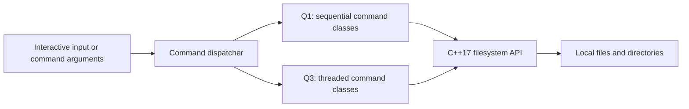

# C++ Filesystem & Concurrency Lab

A Linux command interpreter exploring filesystem operations in C++17, plus a bounded-worker copy experiment with a reproducible benchmark.

## Why this project exists

Filesystem utilities provide a concrete way to study directory traversal, command parsing, I/O behavior, and thread coordination. This project implements a small command set in two versions so those choices can be inspected side by side.

## Architecture



`Q1.cpp` and `Q3.cpp` are separate legacy executables. Each dispatches `cd`, `ls`, `cp`, `mv`, and `rm`; Q3 still creates threads recursively. The separate `bounded_copy.cpp` experiment compares the same file-copy implementation with sequential execution and with a bounded worker pool. It does not replace Q3's other commands.

## Engineering Highlights

- Command-specific classes separate dispatch from filesystem operations.
- `std::filesystem` handles paths, directory iteration, copies, moves, and removals.
- Recursive traversal provides a direct comparison between sequential work and per-directory threading.
- The threaded listing implementation coordinates console output with a mutex.
- Shell scripts generate file trees and time copy/move/remove workloads.
- A separate copy experiment bounds both worker count and queued jobs, verifies output hashes, and reports repeated sequential and parallel measurements.

## Tech Stack

**Language:** C++17. **Platform:** Linux, POSIX-style shell. **Libraries:** C++ standard library, `std::filesystem`, `std::thread`, `std::mutex`. **Build:** GCC and Make.

## How It Works

With command arguments, the executable performs one operation and exits. Without arguments, it reads commands interactively until `exit`. Options are implemented per command; use `-h` to inspect them.

This is a focused command-interpreter experiment. It does not implement process launching, pipelines, redirection, shell job control, or complete POSIX command compatibility.

## Setup

Use Linux with a C++17-capable GCC toolchain. Compile the programs directly:

```bash
git clone https://github.com/yashwant938/OOPD-Project.git
cd OOPD-Project
g++ -std=c++17 -Wall -Wextra -O2 Q1.cpp -o Q1
g++ -std=c++17 -Wall -Wextra -O2 -pthread Q3.cpp -o Q3
```

The existing `MAKEFILE` combines compilation with workload generation and mutation. Avoid using it as a quick-start build: `second.sh` writes roughly **110,100 MiB** of file data before copy overhead, and `four.sh` copies, moves, and deletes generated paths. Some script labels disagree with their actual `dd` sizes.

## Example

Start with read-only commands:

```bash
./Q1 ls -h
./Q1 ls
./Q3 ls
```

Both listing commands enumerate the current directory. Output order can vary, especially during threaded traversal. To try the interactive interpreter, run `./Q1`, enter `ls`, and then `exit`. Use disposable directories for copy, move, or remove experiments.

## Bounded copy experiment

```bash
g++ -std=c++17 -O2 -Wall -Wextra -Wpedantic -pthread bounded_copy.cpp -o bounded_copy
python3 -m unittest discover -s tests -v
python3 benchmark.py --repeats 7
```

The benchmark creates its own small temporary trees, runs each mode seven times in alternating order, verifies every copied file by SHA-256 outside the timed interval, and removes only its own temporary directory. It writes raw timings and system details to `benchmark-results.json`. It does not run the old workload scripts. Each timing includes process startup and filesystem traversal; the OS cache is likely warm.

One WSL2 run with 12 available logical CPUs produced these medians ([all samples and environment](benchmark-results.json)):

| Synthetic workload | Sequential | 4-worker pool |
| --- | ---: | ---: |
| 256 files × 4 KiB | 7.535 ms | 10.708 ms |
| 8 files × 512 KiB | 7.473 ms | 6.830 ms |

These are short local measurements, not a general speedup claim: thread overhead, storage, caching, operating system, and background activity affect results. This compares two modes of `bounded_copy`, not Q1 against Q3.

For manual use, `./bounded_copy SOURCE NEW_DESTINATION WORKERS` accepts `0` for sequential or `1`–`32` for the worker pool. The destination must not exist and must be outside the source tree. It copies regular files and directories, rejects symlinks and other special files, and never overwrites existing files. A failed operation can leave a partial newly created destination for inspection. It is an educational tool, not a hardened backup utility; do not use it on data being modified concurrently.

The traversal producer creates directories and feeds a queue capped at twice the worker count; workers copy files and never enqueue dependent work. Failures are reported and workers are joined. The test suite checks equivalent outputs, invalid arguments, existing/nested destinations, and symlink refusal.

## Engineering Challenges

- Thread creation and I/O contention can outweigh parallelism; no reproducible speedup is claimed.
- The legacy Q3 per-directory threading strategy remains unbounded; the bounded pool is scoped to the separate copy experiment.
- Parsing and error handling are intentionally limited: quoted interactive paths, missing arguments, filesystem exceptions, and end-of-input need stronger handling.
- Permission failures, symlinks, hidden files, and concurrent filesystem changes require explicit semantics and regression tests.

## Future Improvements

- Add unit and integration tests against small temporary directory trees, including failure paths.
- Separate build targets from benchmarks and parameterize dataset sizes.
- Integrate a bounded executor into the legacy commands after defining their error and interaction semantics; measure CPU and storage effects across more workloads.
- Add sanitizer builds, Linux CI, and documented concurrency invariants.
