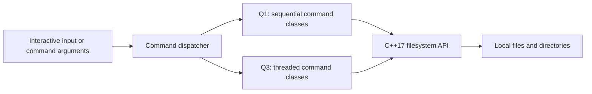

# C++ Filesystem & Concurrency Lab

A Linux command interpreter comparing sequential and threaded filesystem operations in C++17.

## Why this project exists

Filesystem utilities provide a concrete way to study directory traversal, command parsing, I/O behavior, and thread coordination. This project implements a small command set in two versions so those choices can be inspected side by side.

## Architecture



`Q1.cpp` and `Q3.cpp` are separate executables. Each dispatches `cd`, `ls`, `cp`, `mv`, and `rm`; the threaded version creates and joins threads during recursive directory traversal.

## Engineering Highlights

- Command-specific classes separate dispatch from filesystem operations.
- `std::filesystem` handles paths, directory iteration, copies, moves, and removals.
- Recursive traversal provides a direct comparison between sequential work and per-directory threading.
- The threaded listing implementation coordinates console output with a mutex.
- Shell scripts generate file trees and time copy/move/remove workloads.

## Tech Stack

**Language:** C++17. **Platform:** Linux, POSIX-style shell. **Libraries:** C++ standard library, `std::filesystem`, `std::thread`, `std::mutex`. **Build:** GCC and Make.

## How It Works

With command arguments, the executable performs one operation and exits. Without arguments, it reads commands interactively until `exit`. Options are implemented per command; use `-h` to inspect them.

This is a focused command-interpreter experiment. It does not implement process launching, pipelines, redirection, shell job control, or complete POSIX command compatibility.

## Setup

Use Linux with a C++17-capable GCC toolchain. Compile the programs directly:

```bash
git clone https://github.com/yashwant938/OOPD-Project.git
cd OOPD-Project
g++ -std=c++17 -Wall -Wextra -O2 Q1.cpp -o Q1
g++ -std=c++17 -Wall -Wextra -O2 -pthread Q3.cpp -o Q3
```

The existing `MAKEFILE` combines compilation with workload generation and mutation. Avoid using it as a quick-start build: `second.sh` writes roughly **110,100 MiB** of file data before copy overhead, and `four.sh` copies, moves, and deletes generated paths. Some script labels disagree with their actual `dd` sizes.

## Example

Start with read-only commands:

```bash
./Q1 ls -h
./Q1 ls
./Q3 ls
```

Both listing commands enumerate the current directory. Output order can vary, especially during threaded traversal. To try the interactive interpreter, run `./Q1`, enter `ls`, and then `exit`. Use disposable directories for copy, move, or remove experiments.

## Engineering Challenges

- Thread creation and I/O contention can outweigh parallelism; no reproducible speedup is claimed.
- The current per-directory threading strategy is unbounded and needs a bounded worker pool.
- Parsing and error handling are intentionally limited: quoted interactive paths, missing arguments, filesystem exceptions, and end-of-input need stronger handling.
- Permission failures, symlinks, hidden files, and concurrent filesystem changes require explicit semantics and regression tests.

## Future Improvements

- Add unit and integration tests against small temporary directory trees, including failure paths.
- Separate build targets from benchmarks and parameterize dataset sizes.
- Replace unbounded threads with a bounded executor; measure elapsed time, CPU use, and storage effects over repeated trials.
- Add sanitizer builds, Linux CI, and documented concurrency invariants.
